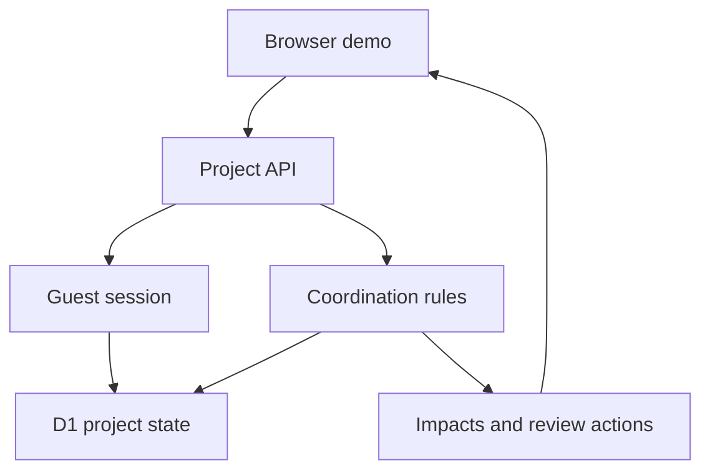

# SiteSync
Coordination intelligence for architecture, interior design and construction.

**ArchScale Guild Hackathon · AS-01 · Individual submission**  
Applicant: Ritik Keshari

[Open the public prototype](https://sitesync-coordination.keshariritik101.workers.dev)

No account is required. Each browser receives a separate synthetic demo session.

## The problem
A drawing change can affect consultants, contractors, vendors, approvals and downstream work. Those relationships often live in messages and individual memory. People may continue against outdated assumptions because they do not know who is affected, who must review, or what is blocked.

SiteSync makes these relationships explicit: task owners, dependencies, change requests, review actions, client decisions and project history live in one workspace.

## The prototype
Maple Residence is a realistic synthetic residential renovation scenario. Five stakeholder roles coordinate twelve tasks. Moving a bathroom wall by 600 mm affects seven downstream tasks, including plumbing drawings, tile quantities, ordering, delivery and finishes.

1. Record a change against a task or deliverable.
2. Trace downstream work and explain each impact through a dependency path.
3. Let the manager confirm the proposed review actions.
4. Switch demo roles and record attributed review notes.
5. Approve or reject as the client after required reviews.
6. Track remaining prerequisite blocks and inspect project memory.

The role switcher is simulation, not real account authentication.

## Capabilities and AS-01 coverage
| Requirement | Implementation |
| --- | --- |
| Stakeholders and responsibilities | Named roles, task owners and responsibility descriptions |
| Activity and change tracking | Tasks, change requests and status transitions |
| Coordination intelligence | Breadth-first dependency traversal with explainable impact paths |
| Dependencies | Prerequisite graph, cycle prevention and transitive blocking |
| Action tracking | Confirmed review actions with owners, notes and completion |
| Approvals | Client decision gated by required reviews |
| Alerts | In-app notices and blocked-work indicators |
| Project memory | Searchable history of decisions, changes and actions |
| Working demonstration | Public browser demo with per-session D1 persistence |

## Design decisions
- **Explicit rules instead of runtime AI:** impact calculations are deterministic, explainable and testable. Accuracy depends on recorded dependencies.
- **Manager confirmation:** recording a change proposes coordination actions; confirmation activates reviews and change holds.
- **Separate holds and prerequisites:** approval releases the change hold but does not complete unfinished prerequisite work.
- **Required review evidence:** a review includes a note, reviewer and timestamp.
- **Versioned state:** conditional writes reject stale updates from another tab.
- **One project aggregate:** storing JSON in D1 keeps this prototype compact; larger systems would need more normalized task/event storage.
- **Public demo isolation:** random guest cookies select separate saved scenarios, rather than one globally shared demo.

## Architecture
| Layer | Technology and responsibility |
| --- | --- |
| Interface | React 19, TypeScript, Tailwind CSS, existing Shadcn/Base UI components |
| Framework | Vinext with Vite; Next-compatible app routes |
| API | Cloudflare Worker, request validation with Zod |
| Domain | Shared TypeScript coordination engine |
| Storage | Cloudflare D1 (SQLite), Drizzle ORM |
| Deployment | Wrangler 4.92.0; static assets and Worker on workers.dev |
| Verification | Node test runner, TypeScript, build validation, Python SQLite checks |



The API reads a server-issued cookie, hashes its random token into a storage key, validates commands, applies workflow rules and conditionally saves a new project version. Production cookies use HttpOnly, Secure and SameSite=Lax. Cookies expire after 30 days; clearing a cookie starts a fresh demo but does not delete its previous database record.

## Authentication boundary
This Cloudflare submission is a **public demo**. The page always uses guest mode, the team sign-in link is hidden, and `app/api/identity.ts` returns null regardless of request headers. Team API access therefore returns 401.

The repository retains earlier team storage, membership checks and their tests as development work. Shared team accounts are **not enabled in this deployment**. The unused historical hosting identity helper must not be re-enabled on a public Worker without independent verified authentication.

## Main source files
- `lib/coordination.ts`: data model, dependency tracing and workflow commands.
- `lib/guest.ts`: isolated demo sessions.
- `app/workspace.tsx`: interactive project workspace.
- `app/api/project/route.ts`: validated, versioned project reads and writes.
- `app/api/identity.ts`: disabled team identity boundary for this deployment.
- `db/` and `drizzle/`: storage and schema.
- `cloudflare.config.json`: durable Worker and database configuration.
- `scripts/prepare-cloudflare.mjs`: restores deployment settings after each build.

## Run and deploy
Use Node 24. From the project folder:
```sh
npm ci
npm test
npm run typecheck
npm run build
```
Windows PowerShell is supported by these commands. See [setup and deployment](docs/SETUP.md) for local storage, script approvals and deployment.

## What AI helped with
AI assisted with translating the problem statement into scope, drafting UI and TypeScript code, dependency/workflow logic, test cases, debugging, documentation and guided deployment commands. The applicant selected AS-01, directed the scope, performed reported browser checks and ran the Cloudflare deployment from their computer.

The prototype does not use an AI model at runtime. AI assistance during development is distinct from product functionality. Claims about benefits are goals; no measured time or cost savings are asserted.

## Validation and limits
This package passed all 21 Node tests and the production build. The build also successfully applied the persistent Cloudflare configuration. The tests cover domain rules, retained team access logic and guest sessions.
The earlier public demo was manually checked by the applicant for role switching, approvals, dependency changes and persistence. Cloudflare deployment success was reported from Wrangler, including the subsequent identity fix. The latest sign-in-link removal still needs a final browser check. Automated checks cover domain logic and guest sessions; retained team tests do not mean team sign-in is enabled.

This is not a security audit or field trial. Guest database cleanup, abuse controls and production scale have not been validated. Alerts are in-app; no email or WhatsApp delivery is implemented. Updates require refresh rather than real-time subscriptions.

## What I would build next
1. Independent authentication and verified team membership.
2. Links between drawings, revisions and tasks.
3. Live updates and configurable notification delivery.
4. Guest retention/cleanup and abuse protection.
5. Field evaluation with a studio and more detailed project storage.

